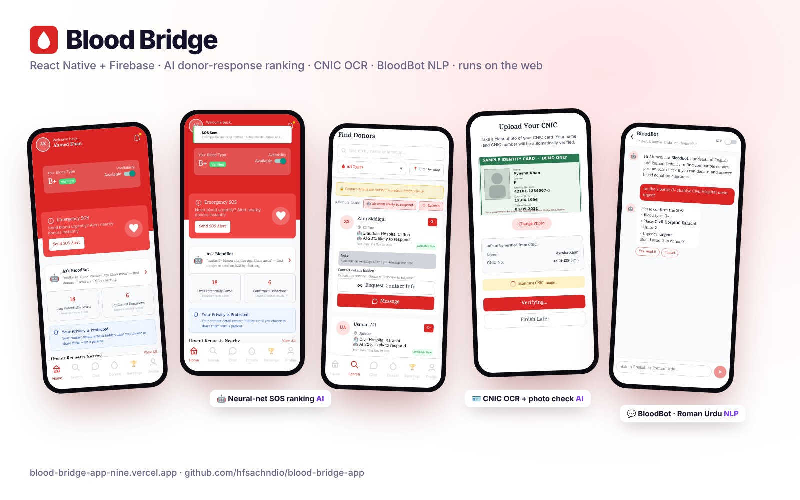
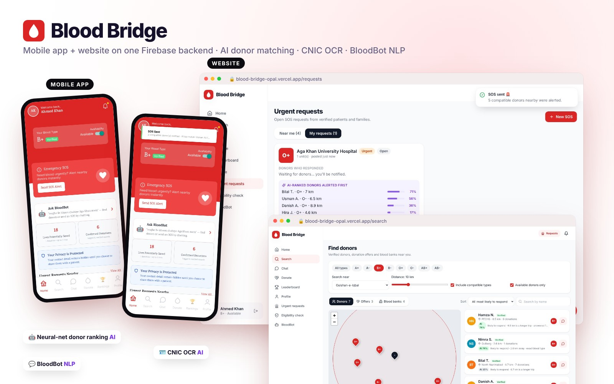
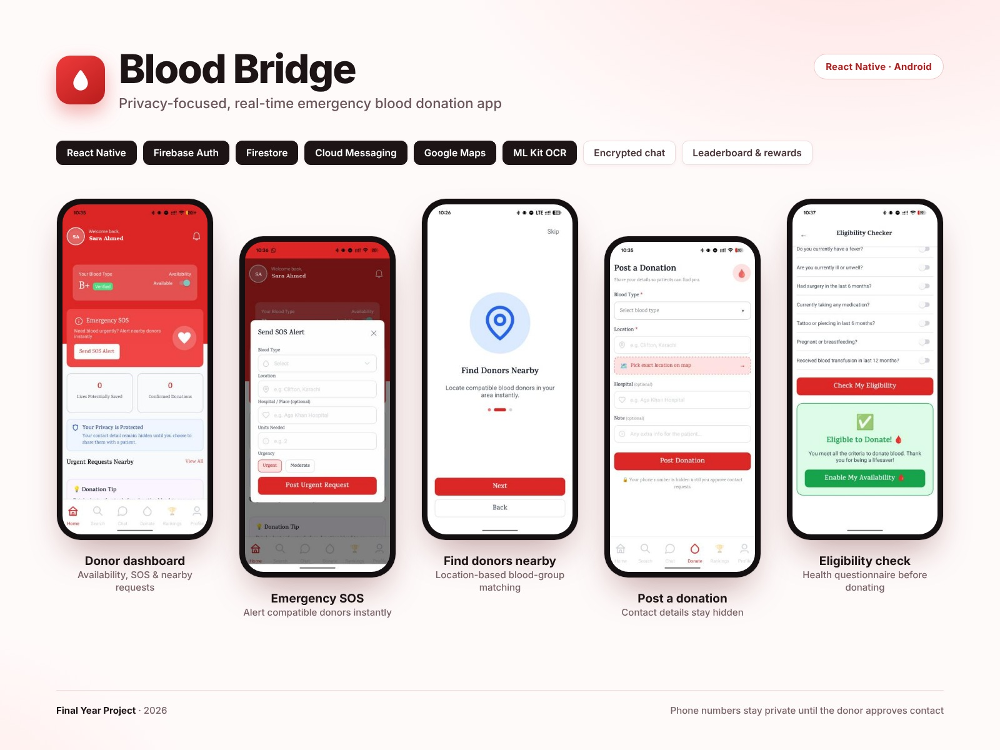

# Blood Bridge: Mobile App (with BloodBot NLP)

**Blood Bridge** is a React Native and Firebase app for emergency blood donation in Karachi. It connects patients with nearby, compatible, CNIC-verified donors through SOS alerts, a donor map, chat and a points-based leaderboard.

This repository is my copy of the team's app. My additions are **BloodBot**, an on-device NLP assistant that understands **English and Roman Urdu**, an **AI donor-response model** that ranks who to notify for an SOS, an **AI CNIC reader** with photo-quality checks, and a **web build** of the app deployed on Vercel.

**Try the app in your browser:** https://blood-bridge-app-nine.vercel.app (same React Native code via react-native-web)
**Website version:** https://blood-bridge-opal.vercel.app ([source](https://github.com/hfsachndio/blood-bridge-web))

**One backend for both:** the app and the website use the same Firebase project (`blood-bridge-78f97`): same logins, same Firestore collections, same security rules (`firestore.rules`). An SOS sent from the app appears on the website live, and the other way round.

> **Credits:** the original app was built as a team project, and I was one of the contributors. The first commit in this repository is the team's original source. Every commit after it, including the NLP assistant, is my own work.



**Videos:** [mobile app](docs/media/BloodBridgeApp-demo.mp4) · [website](docs/media/BloodBridgeWeb-demo.mp4) · [app + website together](docs/media/BloodBridge-app-and-web.mp4)





## Features (team app)

- **Accounts and verification:** email sign-up and login, then a profile builder (CNIC with ML Kit text recognition, blood type, date of birth, weight). Accounts stay pending until an admin approves them.
- **SOS requests:** post an urgent request; donors are notified (Firebase Cloud Messaging plus an in-app feed) and can respond.
- **Search:** donation offers on Google Maps with blood-type and radius filters. Phone numbers stay hidden until the donor approves a contact request.
- **Chat:** real-time one-to-one messaging.
- **Donate:** post a donation offer with a location picked on the map.
- **Leaderboard and awards:** 100 points per offer and 150 per logged donation, plus badges.
- **Donation history, certificates and an eligibility checker** (WHO and Pakistan guidelines).
- **Admin dashboard** for reviewing CNIC submissions.

## BloodBot: NLP assistant (my addition)

You can open BloodBot from the **Ask BloodBot** card on the Home screen or from **Profile → Ask BloodBot**.

| Example | What happens |
|---|---|
| `meri ammi ko 2 bottle AB- chahiye indus hospital mein, critical` | It fills every SOS field from one sentence, asks you to confirm, then posts to Firestore and notifies compatible, available donors |
| `send an sos` → `B+` → `Aga Khan` → `2` → `urgent` | It asks for each missing field in turn; "cancel" stops it at any point |
| `koi O- donor hai Clifton mein?` | It lists compatible donors (exact match plus other compatible types), nearest first, with a **Chat** button |
| `I got a tattoo 2 months ago` / `I'm 17, can I donate?` | It answers from the same eligibility rules the app uses, with the numbers from your message |
| `show urgent requests` | It lists open requests you can donate to, with a **Respond** button |
| `mark me unavailable` | It updates your availability in Firestore |

The **NLP** switch in the header shows the detected intent, the confidence and the extracted entities for each message.

### How it works

Everything is plain TypeScript and runs on the device, with no external AI API and no extra dependencies.

| Stage | File |
|---|---|
| Normalisation: Roman Urdu to English lexicon, stop-words, light stemming | `src/nlp/text.ts` |
| Intent classification: TF-IDF over unigrams and bigrams, cosine k-NN against 250+ labelled phrases (29 intents), with a confidence threshold and an out-of-domain fallback | `src/nlp/classifier.ts` |
| Entity recognition: blood types, typo-tolerant Karachi areas and hospitals (Levenshtein distance), units (including Urdu numbers), age, weight, time since an event, urgency | `src/nlp/entities.ts` |
| Dialogue manager: SOS slot filling, follow-ups and actions | `src/nlp/bot.ts` |
| Firestore data source: the same collections as the rest of the app | `src/nlp/firebaseData.ts` |
| Chat screen | `src/screens/main/bloodBot/index.tsx` |

```bash
npm test -- src/nlp      # 7 tests: intents, entities, SOS dialogue, donor matching, eligibility
```

## AI features (my addition, same models as the website)

| Feature | What it does | Where |
|---|---|---|
| **Donor-response neural network** | A small MLP (10→24→12→1, ReLU) trained with scikit-learn on 6,000 simulated SOS notifications (ROC-AUC 0.84; NDCG@3 0.78 vs 0.68 for nearest-first). It scores each compatible, verified, available donor (distance, days since last donation, exact type, past responses, time of day, urgency …), notifies them most-likely-first, and saves the top five on the request (`aiRanking`). Search sorts donors by the same score and shows "AI 87% likely to respond"; donors see when the AI ranked them a top match. | `src/ai/donorRank.ts`, `src/ai/sosBroadcast.ts` (training code: [blood-bridge-web/ml](https://github.com/hfsachndio/blood-bridge-web/tree/main/ml)) |
| **CNIC reader (computer vision + OCR)** | Phones: Google ML Kit on-device OCR. Web build: brightness/contrast/sharpness checks (variance of the Laplacian), contrast stretch, 2× upscale and Tesseract LSTM OCR in the browser. Both parse the CNIC number, date of birth and name (tolerant of O→0, l→1), ask for a retake when the photo is unusable, and store the result (`cnicCheck`) for the admin. | `src/ai/cnicText.ts`, `src/ai/cnicReader.ts`, `src/ai/cnicReader.web.ts` |
| **BloodBot NLP** | Intent classification, entity recognition and dialogue (above). | `src/nlp` |

```bash
npm test            # AI model parity with scikit-learn, donor ranking, CNIC parsing/quality, BloodBot
npm run typecheck
```

## Web build (Vercel)

`npm run build:web` bundles the app with webpack + react-native-web (`webpack.config.js`). Phone-only modules get small web versions in `web/shims`: OpenStreetMap (Leaflet) for react-native-maps, a file picker for the image picker, the browser date picker, browser geolocation, and the Firebase JS SDK (`src/config/firebase.web.ts`) instead of React Native Firebase. Push notifications stay phone-only; the in-app notification feed works everywhere. On a desktop the app is shown inside a phone frame. `npm run web` starts a dev server.

## Running the app

1. `npm install`
2. Download `google-services.json` for the Android app (`com.bloodbridge`) from the shared Firebase project (or your own) into `android/app/`; see `google-services.example.json`. Deploy `firestore.rules` to the project.
3. `npm run android` (or `npm run ios`)

**Stack:** React Native 0.79, React 19, TypeScript, Firebase (Auth, Firestore, Messaging), React Navigation, react-native-maps, ML Kit text recognition, react-native-web + webpack (web build), Jest, GitHub Actions. Free Firebase Spark plan: CNIC photos are compressed and kept in the user document, so Cloud Storage isn't used.
